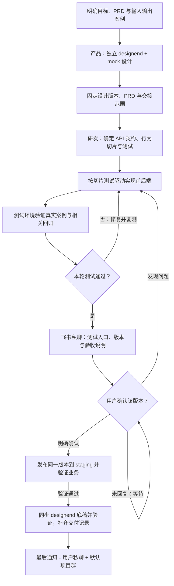

# 产品设计与研发协作模板

这套模板帮助产品和研发按同一流程协作：独立设计、固定交接、测试环境开发验证、用户确认后发布staging，更新设计底稿，最后通知用户和默认项目群。

## 流程图



关键需求不明确时先用 grill-me 逐项澄清；已满足的设计与契约直接复用。发布后的 frontend 单向同步为下一轮 designend 底稿，保留 mock 和未交付设计。

## 从哪里看

- [项目与模块入口](project/README.md)：了解各模块做什么、怎样使用。
- [工作流程](project/docs/workflow/README.md)：了解每个阶段和交接方式。
- [Skills导航](project/.agents/skills/README.md)：查看Agent怎样执行任务。
- [测试与评分](project/workflow-evaluation/README.md)：用实际任务改进Skills。

## 怎么采用

1. 阅读[采用说明](project/docs/workflow/adoption.md)，将模板与已有规则合并。
2. 选择一个模块，按[装配示例](project/docs/workflow/example.md)跑完整个流程。
3. 根据真实问题调整规则与Skills，再推广到其他模块。

首次接入还需登记测试环境、staging、飞书私聊和默认群，见[项目配置示例](project/docs/workflow/project-settings.example.json)。模板上传完成不代表业务项目已接入。

## 日常怎么使用

接入业务项目后，不需要先填写所有模板。直接说明项目、目标和已有资料，附上 PRD、设计和案例链接即可；Agent 会先读取现有规则，指出缺口，再按项目 workflow 推进。

### 开发

```text
在 commercial-bidding-tools 项目开发“从已保存标书继续调整”。
PRD：链接
设计：designend 链接或产品交接版本（如果有）
案例：这份 Word，按这个要求调整，预期得到这个结果。
按项目 workflow 执行，测试环境验收通过后通知我，等我确认再发布 staging。
```

### 产品

```text
在 commercial-bidding-tools 项目设计“从已保存标书继续调整”。
目标：用户完成什么，成功后看到什么结果。
PRD：链接
设计：designend 链接或需要调整的页面范围
案例：输入、操作、预期输出和允许差异
未确定：还没有决定的交互、异常或业务规则
请在独立 designend 中用 mock 完成界面与交互，按项目 workflow 整理设计交接。
标出需要我确认的问题；本次只做设计。
```

产品可以先交付 designend、PRD 和案例；开发会检查它们是否足够实现。测试环境通过后，开发会发起版本验收，收到明确确认前不会发布 staging。

本包提供文档、10个Skills和评估工具；尚未包含可运行的业务应用，也未修改现有项目。实际完成的检查见[验证记录](VALIDATION.md)。
