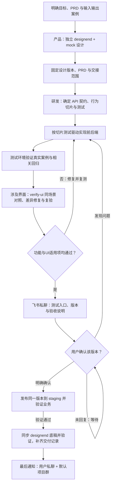

# 产品设计与研发协作模板

这套模板帮助产品和研发按同一流程协作：独立设计、固定交接、测试环境开发验证、用户确认后发布staging，更新设计底稿，最后通知用户和默认项目群。

## 流程图



关键需求不明确时先用 grill-me 逐项澄清；已满足的设计与契约直接复用。发布后的 frontend 单向同步为下一轮 designend 底稿，保留 mock 和未交付设计。

## 从哪里看

- [项目与模块入口](project/README.md)：了解各模块做什么、怎样使用。
- [工作流程](project/docs/workflow/README.md)：了解每个阶段和交接方式。
- [Skills导航](project/.agents/skills/README.md)：查看Agent怎样执行任务。
- [测试与评分](project/workflow-evaluation/README.md)：用实际任务改进Skills。

UI变更在第5步执行 [verify-ui](project/.agents/skills/verify-ui/SKILL.md)：固定已确认设计与测试版本，保留同场景成对截图，逐项修复并复验；功能验证、UI对齐与产品验收分别报告。没有可见影响时说明不适用。

## 怎么采用

1. 阅读[采用说明](project/docs/workflow/adoption.md)，将模板与已有规则合并。
2. 选择一个模块，按[装配示例](project/docs/workflow/example.md)跑完整个流程。
3. 根据真实问题调整规则与Skills，再推广到其他模块。

首次接入还需登记测试环境、staging、飞书私聊和默认群，见[项目配置示例](project/docs/workflow/project-settings.example.json)。模板上传完成不代表业务项目已接入。

## 日常怎么使用

接入业务项目后，不需要先填写所有模板。直接说明项目、目标和已有资料，附上 PRD、设计和案例链接即可；Agent 会先读取现有规则，指出缺口，再按项目 workflow 推进。

### 开发

```text
在 commercial-bidding-tools 项目开发“从已保存标书继续调整”。
PRD：链接
设计：designend 链接或产品交接版本（如果有）
案例：这份 Word，按这个要求调整，预期得到这个结果。
按项目 workflow 执行，测试环境验收通过后通知我，等我确认再发布 staging。
```

### 产品

```text
在 commercial-bidding-tools 项目设计“从已保存标书继续调整”。
目标：用户完成什么，成功后看到什么结果。
PRD：链接
设计：designend 链接或需要调整的页面范围
案例：输入、操作、预期输出和允许差异
未确定：还没有决定的交互、异常或业务规则
请在独立 designend 中用 mock 完成界面与交互，按项目 workflow 整理设计交接。
标出需要我确认的问题；本次只做设计。
```

产品可以先交付 designend、PRD 和案例；开发会检查它们是否足够实现。测试环境通过后，开发会发起版本验收，收到明确确认前不会发布 staging。

本包提供文档、12个Skills和评估工具；尚未包含可运行的业务应用，也未修改现有项目。实际完成的检查见[验证记录](VALIDATION.md)。

### Bug清单修复

将 Markdown 或飞书 Bug 清单交给 [buglist-fix](project/.agents/skills/buglist-fix/SKILL.md)，说明本轮处理范围即可。采用时需配置项目自己的测试环境、飞书身份、原清单字段和漏斗表；模板本身不包含真实绑定。

```text
使用 buglist-fix 逐个处理这份 Bug 清单：链接或文件路径。
本轮范围：修复中、未通过。
自行补齐原始资料和隔离测试，验证正式页面、真实后端与预期结果。
每个修复关联独立 PR，结果回写原表及漏斗；整批测试通过后通知我验收，
等我明确确认该测试版本，再发布 staging。
```

| 步骤 | Agent 做什么 | 留下什么结果 |
|---|---|---|
| 1. 接收清单 | 读全指定范围、截图、附件和历史 PR，核对负责人及累计轮次 | 固定本轮 Bug 范围，每条建立或恢复本地记录 |
| 2. 复现与归因 | 从原记录确定验收目标，自行取得获准的原始资料，在隔离环境复现并证明根因 | 原始输入、预期来源、复现步骤、技术原因与流程逃逸原因 |
| 3. 逐项修复 | 一次处理一个 Bug，先补失败回归再修改；每 Bug 累计最多五轮 | 每轮假设、提交、测试及结果；第3、4、5轮在已授权范围内直接继续；五轮未解决则停止该项修改，向用户说明疑问，继续独立项 |
| 4. 验证与 PR | 从正式页面走真实 API 和隔离存储，检查原操作、文件内容及刷新后状态；定向验证通过后交付独立 PR | 单 Bug 验证证据，原表“关联技术交付PR”及处理记录，写后回读 |
| 5. 整批验证 | 将成功候选按固定提交组合，逐项回放原业务案例与受影响回归 | 明确哪些通过、失败、未复现或阻塞，更新原表和漏斗，不把全部尝试称为全部解决 |
| 6. 用户确认 | 真实测试完成后，私聊发送测试入口、固定版本、结果及遗留项 | 用户对该候选的明确确认；未确认不发布 staging |
| 7. 发布收尾 | 发布同一制品到 staging 并只读验证，按项目流程同步设计底稿、记录交付 | 最后分别通知用户和默认项目群，回写实际发布结果 |

**代理负责把验证做完。** 单测或局部文件回放通过、创建 PR 都不是停止点，不把常规复验转交用户。无法复现时继续核对原路径、输入、状态和环境；正常的新案例只作对照，不能代替原失败场景。只有关键业务歧义、真实权限缺口、修复次数耗尽及最终发布确认需要用户参与；追加轮次须明确获准，历史不清零。

所有调试、写入和生成测试都在隔离测试环境完成；staging 仅作获准的只读取证及验收后的发布目标。预置历史任务结果须说明，不冒充重新生成成功。高风险、主流程或重复 Bug 按[回归晋升规则](project/.agents/skills/buglist-fix/references/regression.md)保留长期测试；测试文件存在不代表已接入 CI。

每个 Bug 在 `docs/spec/jobs/<year>/<BUG-ID>/` 保留 `bug.json`（结构化阶段、轮次、归因与事件）和 `bug.md`（调查与证据）。飞书原清单展示处理结论和 PR；漏斗的统计 Tab 展示数量、转化和阻塞分布，明细 Tab 展示每条 Bug 停在哪一步。阶段变化时同步并回读；没有调度配置就没有后台自动刷新。产品验收状态不能由 Agent 代填，PR、测试通过、用户验收和发布分别记录。具体字段与统计口径见[漏斗约定](project/.agents/skills/buglist-fix/references/funnel.md)。
